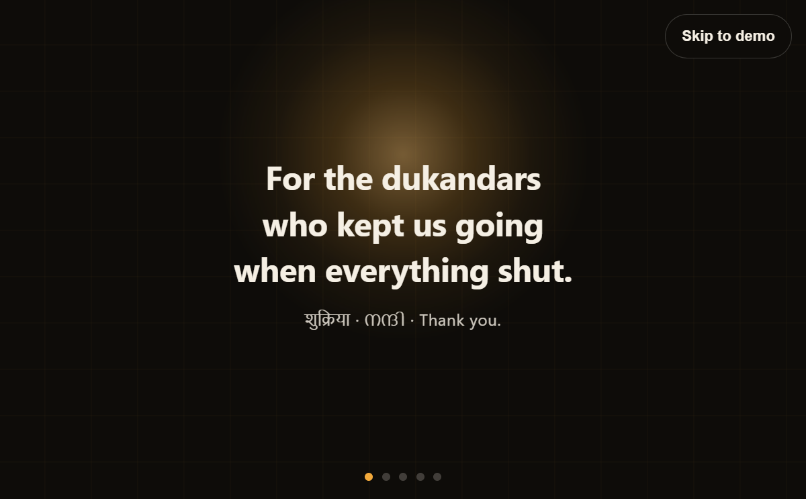
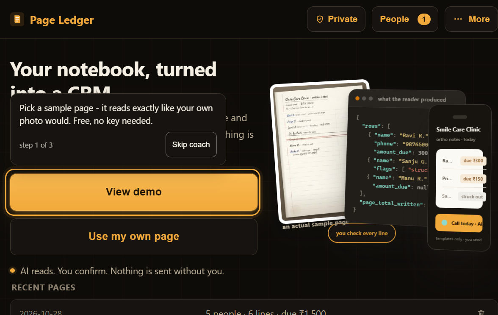
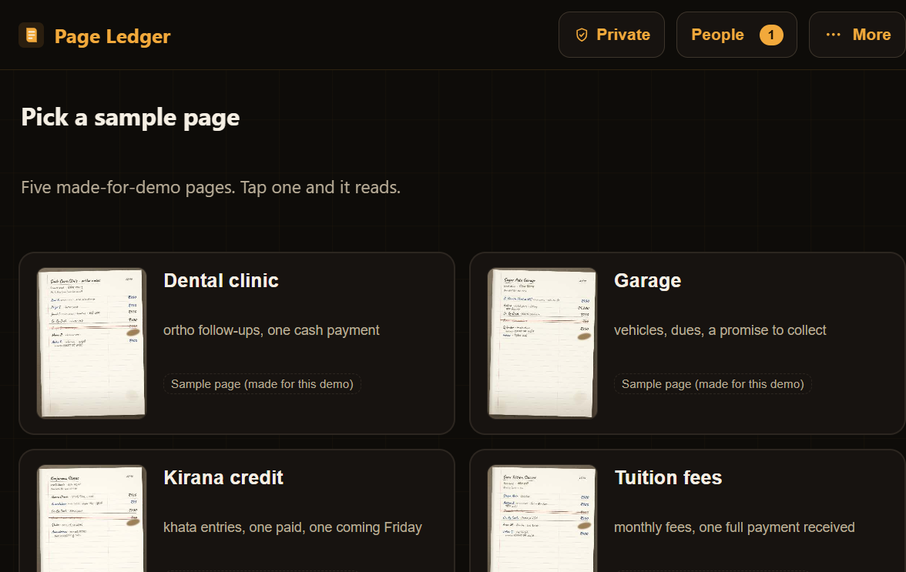
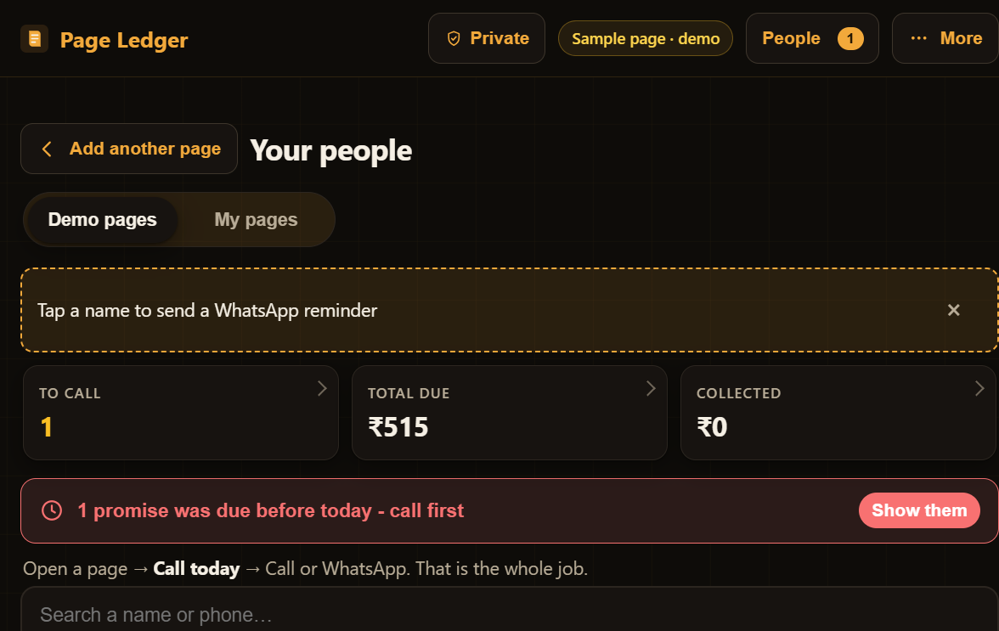
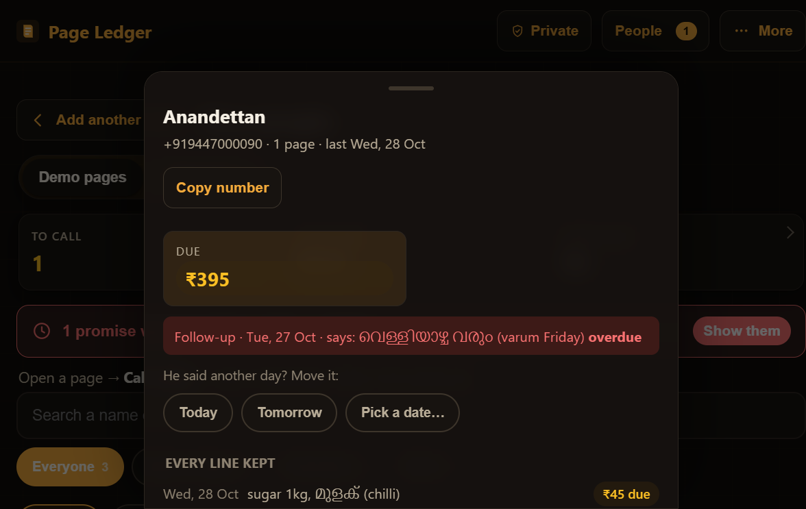
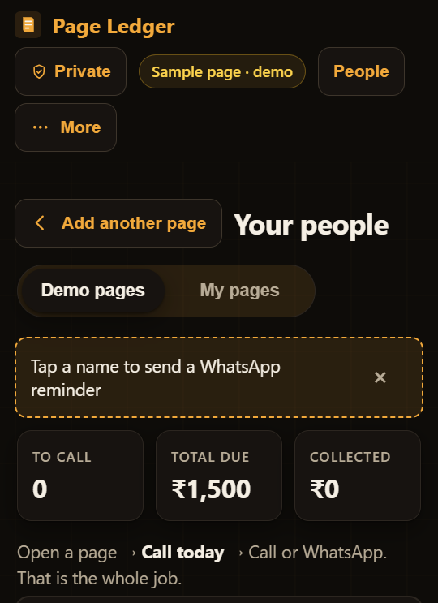

# Page Ledger

A photo of a paper shop notebook becomes a working mini-CRM: customers, phone
numbers, money owed and received, follow-up lists - and WhatsApp in one tap.

Built for the **Meta Global AI Developer Hackathon** (Oct 26 - Nov 4, 2026,
Indie Developer track). Page reads and the owner's Q&A run on **Muse Spark Open**
served from a Modal shared endpoint; voice notes on **Muse Voice Transcribe**
(Meta Model API). All AI calls through one module, `netlify/functions/_lib/ai.js`.

- Stack: plain HTML/CSS/JS (ES modules) + Supabase + Netlify Functions. **Zero npm dependencies.**
- Project plan and rules for agents: see `AGENTS.md`.

## Screens

Captured from the running app (desktop and 360px mobile), in `docs/screens/`:

| | |
|---|---|
|  |  |
|  |  |
|  |  |

The full walk (all five story scenes, review, ask, More menu, own-page, mobile set) lives in `docs/screens/`.

## Status

- **Stage 0 done** - AI spike, mock pipeline verified end-to-end
- **Stage 1 done** - upload screen, extraction function, full review table
- **Stage 2 done, demo form** - saving + recent pages work today via the
  on-device demo store; **no sign-in wall in demo** (this browser is the
  account); the real Supabase project connects at the end with
  `docs/SUPABASE-STEPS.md`
- **Stage 3 done** - People view: who to call today, WhatsApp pre-written templates the owner sends themselves
- **Stage 4 done** - voice follow-up notes: tap the mic, it becomes editable text (Muse Voice Transcribe; mock fixture until a key exists)
- **Stage 5 done** - trust panel ("How this page was read": kept/struck lines, blank fields, read confidence, cost receipt), remove a saved page, one-tap demo reset
- **Stage 6 done** - "Ask my ledger": grounded owner Q&A that cites exactly which figures it used (mock answer labeled demo until a key exists)
- **Demo sections 1-4 done** - sample-first home + coach; believable photographed sample pages; interactive rows (photo locate, one-tap confirm, undo), people search/history, typed ask; a true 3D hero scene (the page, the JSON it produced, the mini-CRM phone)
- **Stage 7 hardening done** - live-mode budget caps (`LIVE_CALLS_PER_MINUTE`/`LIVE_CALLS_PER_DAY`) so runaway traffic can never burn the key, each answered with a friendly note pointing at the sample pages; bundled sample pages are always served from saved fixtures in any mode and never spend credits
- **Pre-submission polish done** - trust shield in the top bar ("where do my pages live", one tap, any screen); overdue strip on People (red, "N promises were due before today", one tap shows them, Done clears it); same-photo cache (the identical read never runs twice in a session); save haptic; sample fixtures bake day-0 demo state (one overdue regular per fresh demo) so "Call today" is never empty
- **Redesign done (Oct 28)** - the app now opens with a five-scene story (a dedication to the dukandars with the amber shop lamp, the notebook, the lost promise, the idea, the three trust rules; "Skip to demo" one tap away; plays once per browser; reduced-motion users get a plain page), then a clean landing ("Your notebook, turned into a CRM."), a demo picker with the five sample pages as large cards, the check screen ("Confirm and open my CRM"), and a CRM dashboard: three big stat cards (To call / Total due / Collected), the overdue strip, search + filter chips, a per-person side panel with history and Call/WhatsApp templates, "Ask my ledger", and a Demo pages / My pages switch that keeps sample reads and the owner's own photographs clearly separated. Dark premium identity throughout: deep ink, one amber accent (the shop lamp), glass panels with 1px borders, a faint living grid, glow reserved for the primary button. Admin controls (privacy, erase demo, sign out, how it was built) live in a More menu.
- **CRM + data ownership pass done (Oct 29)** - the three stat cards are now real filters (tap "To call" to see only today's calls, tap again to release; `aria-pressed` + keyboard); person cards get initial discs (amber for today-calls), a chevron tap cue, and red strips for overdue follow-ups (amber stays due-today, in the cards and the panel); filter chips show live counts; a sort row re-orders the Everyone list (Due first / Name A–Z / Recent - Call today stays urgency-ordered); the person panel gains a one-tap "Copy number"; the More menu gains "Download all lines as CSV" (every line, kept/struck/excluded labeled, UTF-8 BOM so Excel opens Malayalam/Hindi correctly), "Download a backup" + "Restore a backup…" (demo mode only - a plain JSON file, restore merges by page id and never deletes), and "Replay the intro"; the favicon and PWA icons are amber now (teal leftover removed), the app is installable (`manifest.json` + icons), and social share cards work (`og-image.png` + Open Graph/Twitter tags); unknown addresses get a real 404 page.
- **Closing-the-loop pass done (Oct 29)** - the person panel now records money received ("Record payment" → amount or one-tap Full → Save): due lines settle oldest first the way a paper ledger gets crossed out, a full settlement also closes the open follow-up, the Collected stat moves up, and Undo brings the previous numbers back; the panel also moves a follow-up ("He said another day? Move it" → Today / Tomorrow / pick a date, confirmed because the owner set it, Undo restores); history lines show what came in AND what is still due on the same line; the More menu groups the owner's data tools under a "Your data" label; the appbar gains depth on scroll, scrollbars go thin and dark, and the empty state gets a drawn notebook glyph.
- **Gateway pass done (Oct 29)** - the reading gateway is wired to **Muse Spark Open on a Modal shared endpoint** (`MODEL_BASE_URL` / `MODEL_API_KEY` / `MODEL_NAME`; keys only in Netlify env vars or a gitignored .env - never logged, never in browser code); `scripts/check-model.js` verifies the endpoint before anything relies on it (lists the exact model ids from GET /models, runs one real read of the dental sample through the app's own pipeline, compares the output field-by-field with the saved fixture, reports tokens and cost - cost only when `MODEL_PRICE_INPUT`/`MODEL_PRICE_OUTPUT` state a real price); if the endpoint does not enforce `response_format` JSON schema, the module falls back to prompting for JSON with the existing validator plus one retry (rule 4), and remembers the finding so later calls skip straight to the working mode; `scripts/record-fixtures.js` now records real reads for **all five samples** (the four made-for-demo pages + the 1860s museum scan), saving model, date and token cost into `js/recorded-fixtures.js`, after which the sample cards honestly say "Real reading recorded \<date\> with Muse Spark Open"; voice notes stay on the Meta Model API (`transcribe.js` untouched); the live-mode budget caps and the friendly sample fallback are unchanged; the landing footer and the More menu say "Built with Muse Spark Open", and the privacy sheet states that in live mode a photo is sent to the model.
- Demo path needs **no Meta API key** and no Supabase project: mock mode serves fixtures (zero credits); live mode is wired and ready for a key

## Next (after the hackathon — not built yet, listed honestly)

The demo judge's redesign wishlist that did not fit the submission window:
in-app language toggles (pages already mix Hindi/Malayalam/English), capture
guide overlay + auto-snap, video onboarding, multi-device sync with conflict
resolution, swipe gestures, and bigger-list pagination. Design principle kept:
the AI reads, the owner confirms, messages are templates the owner sends.

## How saving works right now

- **No Supabase project connected?** The app runs in clearly-labeled
  **demo mode**: pages save and the People view fills up, but
  everything is stored **only in this browser** on this device — and there
  is **no sign-in wall**: the first visit quietly makes a "this device"
  owner. Ideal for a demo of the full loop.
- **Connecting the real project:** follow `docs/SUPABASE-STEPS.md` - exact,
  click-by-click, nothing to install. After that, accounts are real and pages
  + photos go to the user's private cloud account under database rules.

## Run the app

**Easiest way (anyone):** double-click **`Start Page Ledger.bat`** in this
folder. A black window opens and the app opens at http://localhost:8888.
Keep the black window open while using the app. Double-click it again later
and it politely says "already running" instead of erroring.

*(If you ever open `index.html` directly as a file, the app shows a card
with these same instructions instead of a broken page.)*

Command-line way (same thing):

```
node dev-server.js     #  ->  http://localhost:8888
```

Open http://localhost:8888 in a browser (on your phone over the same Wi-Fi, use this PC's IP, e.g. `http://192.168.x.x:8888`).

- **Add a notebook page** opens the camera on a phone (`capture="environment"`); drag-and-drop works on desktop.
- Images are resized in the browser (long edge 1600px, JPEG q0.8) before upload.
- **Try a sample page** runs the whole flow on a made-for-demo ledger page (drawn by `scripts/render-samples.html`, with matching fixture data - mock or sample mode, zero credits).
- The review screen shows the photo beside the editable table: amber = "AI was unsure, check this", red = bad phone; crossed-out rows stay excluded until you tick "keep"; follow-up dates must be confirmed by hand.
- The console logs latency, retries, token usage and estimated cost for every page read.

## Run the spike (Stage 0, terminal)

```
node scripts/spike-extract.js test-pages/page1.jpg --mock
```

Live mode (burns a few hundredths of a cent per page):

1. Put the gateway key in `.env` as `MODEL_API_KEY=...` and set `AI_MODE=live`
   (`MODEL_BASE_URL`/`MODEL_NAME` defaults live in `netlify/functions/_lib/ai.js`;
   run `node scripts/check-model.js` to verify the key and list the exact model ids).
2. Drop 3 notebook photos into `test-pages/`.
3. `node scripts/spike-extract.js test-pages/page1.jpg`

## Hackathon

Meta Global AI Developer Hackathon (Oct 26–Nov 4 2026), Indie Developer track, solo participant.
- Problem statement: **Build for Your World** — Meta's models into small-shop paper ledgers in India.
- Meta models used: page reads + the owner's Q&A on **Muse Spark Open** (Modal shared endpoint, OpenAI-compatible `/chat/completions`; env-driven via `MODEL_BASE_URL`/`MODEL_API_KEY`/`MODEL_NAME`), voice notes on `muse-voice-transcribe-1.0` (Meta Model API). All calls through `netlify/functions/_lib/ai.js`, `AI_MODE=live|mock`. Demo runs in **mock mode** (fixtures, zero credits); live mode is wired and verified with `scripts/check-model.js` before anything relies on it. In live mode a photo of the owner's own page is sent to the reading model - stated in the app's privacy sheet.
- Submission: public repo ✅ (https://github.com/Izaansherif/page-ledger), public live URL (Netlify, Stage 7), 3-minute demo video (docs/DEMO-SCRIPT.md, Stage 7), due **Wed Nov 4, 9:00 PM ET** via the CV platform.
- See `docs/SUBMISSION.md` for the full submission checklist and judging-rubric mapping.
